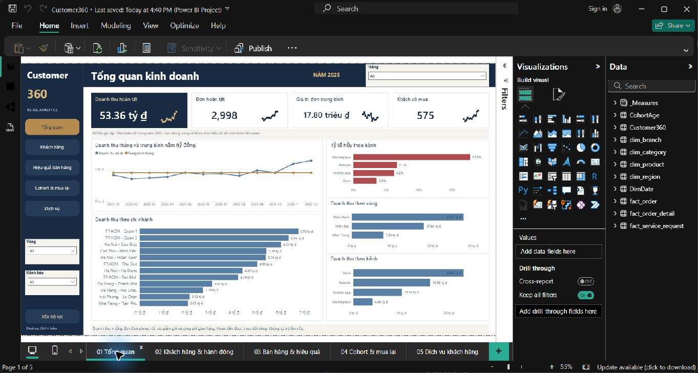

# Customer 360 — retail customer analytics (SQL · Python · Power BI)

Analysis of one year (2025) of **synthetic** data for an electronics retail chain. Goal: find high-value customers, track repurchase, and decide who to contact first.

**Scale:** 600 customers · 575 buyers · 2,998 completed orders · 53.36 bn VND revenue · 8 source tables.

🇻🇳 Báo cáo và dashboard đều bằng tiếng Việt.



More pages: [Customers & actions](dashboard/02-customers.png) · [Sales & performance](dashboard/03-sales.png) · [Cohort & repurchase](dashboard/04-cohort.png) · [Service](dashboard/05-service.png)

## Findings

| Finding | Suggested action |
|---|---|
| 109 Champion customers (18.2%) bring in 50.0% of revenue. | Prioritise retention and care for this group. |
| 66 high-value customers have not bought in more than 90 days. They account for 9.82 bn VND of past revenue. | Run a retention pilot with a control group. |
| Weighted M1 retention is 41.9% (232/554 customers, January–November cohorts). | Track repurchase after month 1 by cohort. |
| 13 service requests are still open (12 customers). CSAT for open requests is 1.77/5, against 4.03/5 overall. | Resolve open requests before sending marketing. |
| Smartphone and TV & Display are below their target margin. | Review pricing, product mix and bundles. |

The past revenue of at-risk customers is not revenue that will certainly be lost.

## How it was built

1. **Data checks:** primary keys, order status and exceptions across the 8 tables. One service request (SR00032) is dated before its purchase, so it is flagged and excluded from service KPIs. It is not deleted.
2. **SQL Server** ([customer360.sql](customer360.sql)) computes:
   - completed-order revenue,
   - RFM-style segments as of 2025-12-31,
   - sales by branch, category and channel,
   - monthly cohorts and service KPIs.
3. **Python** ([reproduce_analysis.py](reproduce_analysis.py)) rebuilds the same tables from the CSVs into [results/](results). [verify_customer360.sql](verify_customer360.sql) reconciles SQL against Python totals: 600 customers, 575 buyers, 2,998 orders and 53,357,307,150 VND all match.
4. **Power BI** ([powerbi/](powerbi)):
   - star schema, Power Query and 51 DAX measures,
   - 5 report pages with navigation and filters,
   - `Validate_*.dax` queries that check KPIs against the source totals.
5. **Next action per customer**, assigned in priority order:

   | Action | Customers |
   |---|---:|
   | Service recovery | 12 |
   | Retention | 48 |
   | Champion care | 81 |
   | Audio cross-sell | 92 |
   | No action | 367 |

## Run

```bash
pip install pandas
python reproduce_analysis.py        # reads data/, writes results/
```

- **SQL:** load the CSVs from `data/` into SQL Server, then run `customer360.sql` top to bottom in one session (it uses `#temp` tables).
- **Power BI:** open `powerbi/Customer360_Final.pbix` to browse the report with its data already embedded. To edit and refresh, open `powerbi/Customer360.pbip` and set the **DataFolder** parameter to your local `data/` folder.

## Repository map

```text
data/        8 source CSVs (synthetic)
results/     tables produced by reproduce_analysis.py
powerbi/     PBIP project, PBIX, DAX measures, Power Query, validation queries
dashboard/   screenshots of the 5 report pages
```

## Limitations

- Synthetic data, one year only: no conclusion about seasonality.
- No campaign log or control group, so the impact of the suggested actions is not measured.
- Segment thresholds are business rules, not a validated predictive model. See [customer-360-ml](https://github.com/ZackingZ2006/customer-360-ml) for a repurchase model.
- Line-level gross profit is before order discounts, shipping, refunds and operating costs.
- No cancellation reasons. `resolution_days` is also filled for open requests, so resolution time uses resolved requests only.
